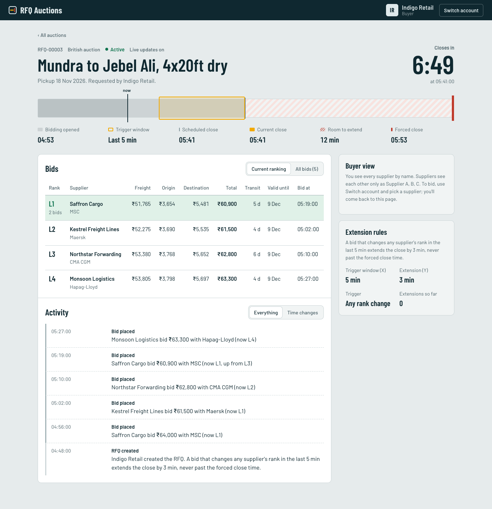
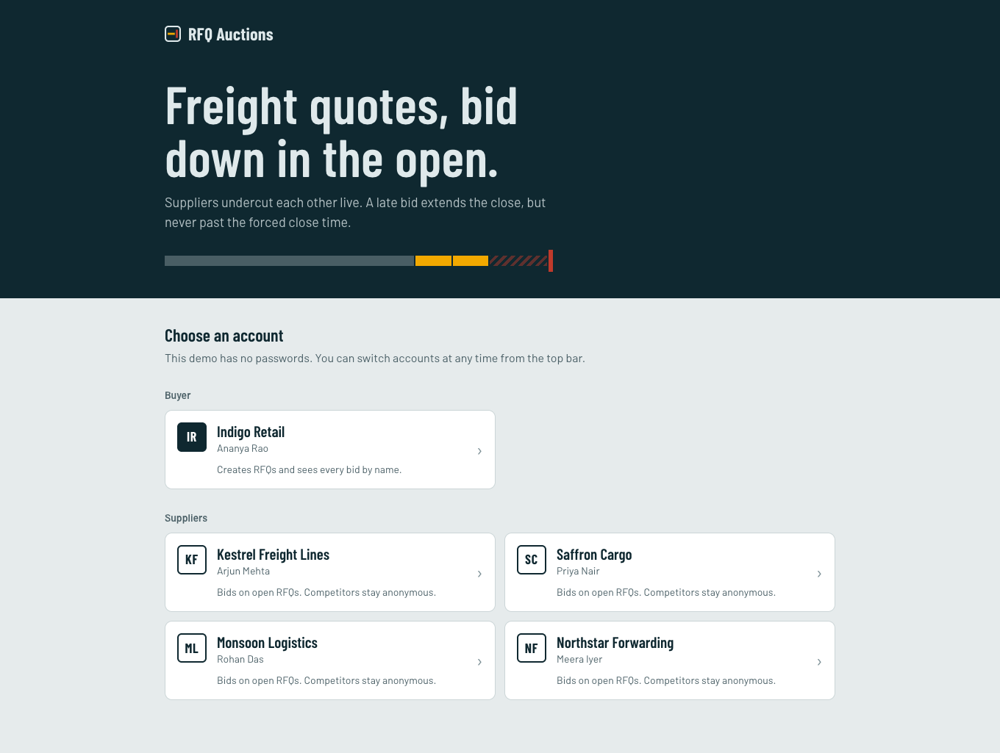
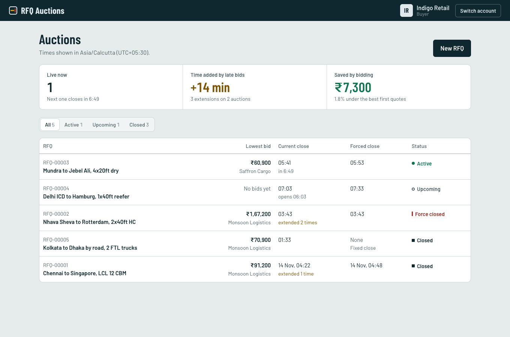
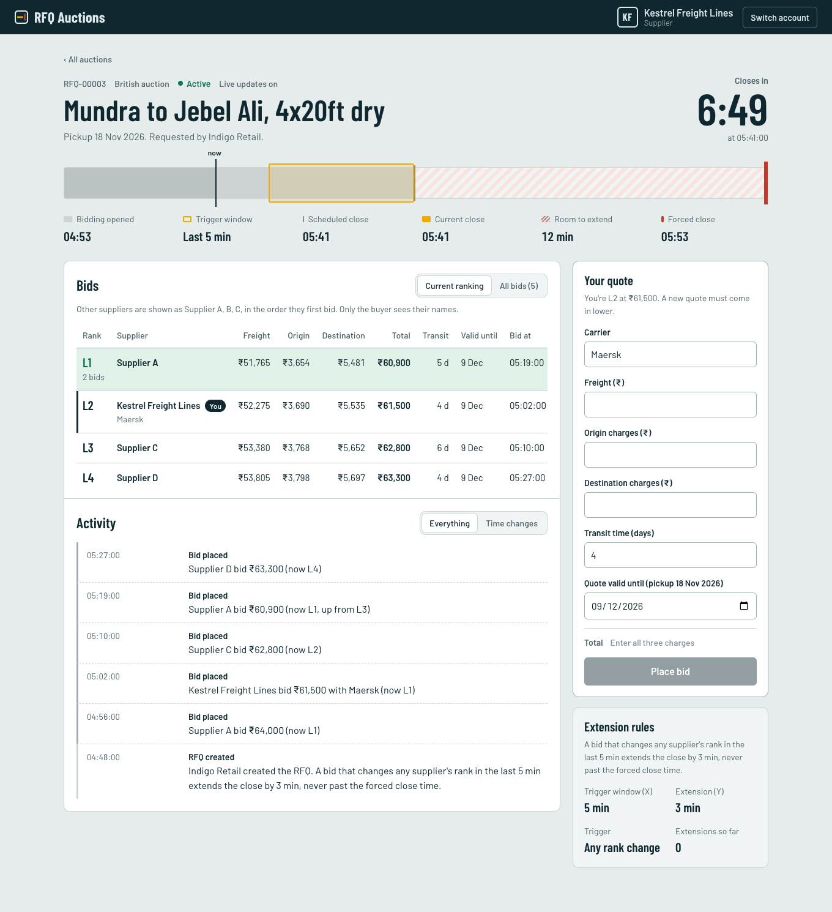
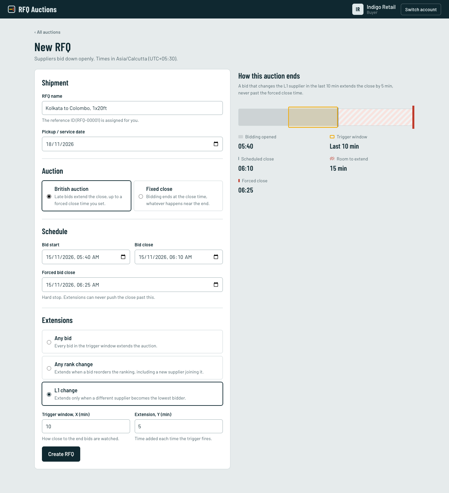
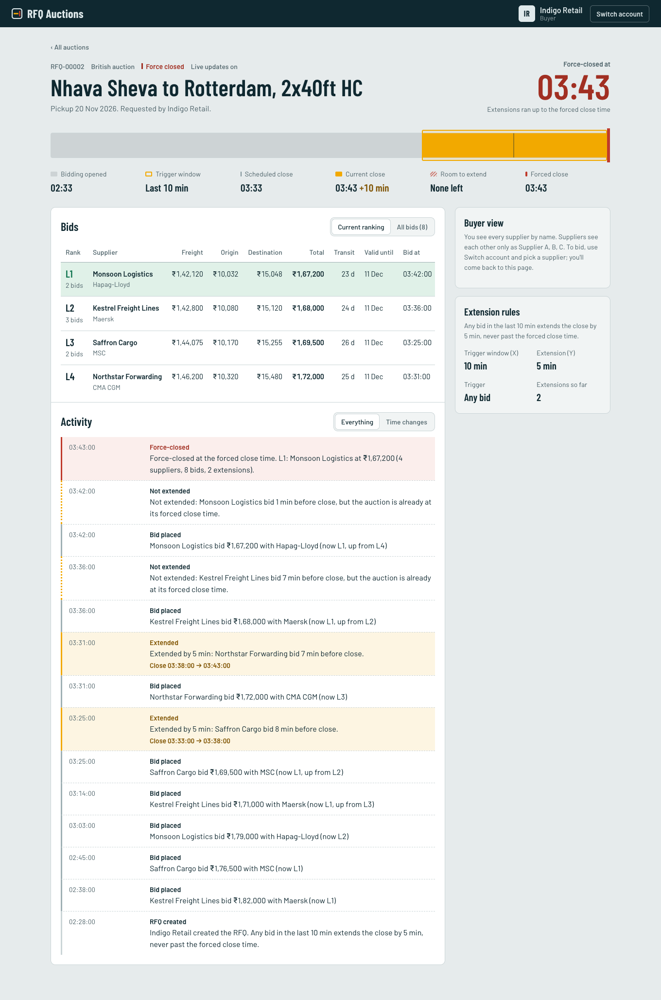

# RFQ British Auctions

A simplified RFQ (Request for Quotation) system with British-auction bidding for freight. Suppliers bid down openly. Bids that land close to the end extend the auction, but never past a forced close time.

**Stack:** FastAPI, SQLAlchemy and Alembic on PostgreSQL. Celery and Redis for the background close job and live updates. React (Vite) for the frontend. Docker Compose runs all of it.



## Deliverables

| Deliverable | Where |
|---|---|
| HLD with architecture diagram | [docs/HLD.md](docs/HLD.md): architecture, bid sequence diagram, design decisions, rules, API |
| Schema design | [docs/schema.md](docs/schema.md) (ER diagram + reasoning) and [docs/schema.sql](docs/schema.sql) (DDL) |
| Backend code | [backend/](backend/): FastAPI app, auction engine, Celery worker, migrations, tests |
| Frontend code | [frontend/](frontend/): React app |

## Run it

You need Docker with Compose.

```bash
docker compose up --build
```

| URL | What |
|---|---|
| http://localhost:8080 | The app |
| http://localhost:8000/docs | Interactive API docs (Swagger) |

On first start the API runs migrations and seeds demo data: one buyer, four suppliers, and five RFQs (live, upcoming, closed, force-closed, and one without the British auction option). The past auctions are built by replaying their bids through the real services, so their activity logs are genuine.

The live demo auction closes about 8 minutes after startup. To start the demo over with fresh times:

```bash
docker compose exec api python -m app.seed --reset
```

## Try it

1. Open http://localhost:8080 and pick an account: the buyer (Indigo Retail) or one of four suppliers. There are no passwords; authentication is mocked. **Switch account** in the top bar keeps you on the same page, so you can look at one auction as the buyer and then as a supplier.
2. The listing opens with a summary. The buyer sees how much time late bids added and how much bidding saved. A supplier sees how many live auctions it leads.
3. Open the **Active** auction as a supplier and place a quote. The form shows the rank it would get before you submit. Competitors appear only as Supplier A, B, C; the buyer sees their names.
4. Inside the last few minutes (the countdown turns amber), a bid that changes the ranking extends the close. The timeline, countdown and activity log update live in every open tab.
5. As the buyer, use **New RFQ**. Choose a British auction or a fixed close. The preview draws the endgame and explains the rules in plain words as you fill in the form.

Watch extensions happen without clicking: a bot keeps bidding on an auction until it closes.

```bash
docker compose exec api python -m app.simulate 3 --every 6
```

## The rules in brief

- **Bidding** is open from bid start (inclusive) to the current close (exclusive).
- **Trigger window (X):** the last X minutes before the *current* close. It moves with each extension.
- **Extension (Y):** `new close = min(current close + Y, forced close)`.
- **Triggers:**
  - *Any bid*: every bid in the window extends.
  - *Any rank change*: a bid that reorders the ranking, including a new supplier joining it.
  - *L1 change*: a different supplier becomes the lowest bidder.
  - These are nested, so each is stricter than the last.
- **British auction option:** with it off, the RFQ has a fixed close. It has no forced close and no X, Y or trigger, and late bids never extend it.
- **Revised bids** must be lower than the supplier's own current bid. Ties go to whoever bid first.
- **Who sees what:** prices are open to everyone. Supplier names are not: a supplier sees its own bids by name and each competitor as Supplier A, B, C. The server leaves hidden names out of its responses.
- **Status** is derived from the clock:
  - *Upcoming*
  - *Active*
  - *Closed*
  - *Force closed*: ended exactly at the forced close time.

[docs/HLD.md](docs/HLD.md#rules-as-implemented) lists every rule and the reasoning behind the choices the spec left open.

## Tests

The backend has 71 tests:

- **Engine unit tests:** the pure auction rules, including a fuzz test comparing the incremental ranking with a brute-force re-sort. They need no database.
- **Visibility unit tests:** supplier aliases and the activity-log text each viewer gets. No database either.
- **API tests:** real Postgres with a frozen clock. They include checks that a supplier's responses never contain a competitor's name.
- **Concurrency tests:** simultaneous bids from 8 threads. They fail when the row lock is removed.

```bash
docker compose up -d db              # tests create their own auction_test database
cd backend
python -m venv .venv && source .venv/bin/activate
pip install -r requirements-dev.txt
pytest                               # or: pytest tests/test_engine.py (no DB needed)
```

## Local development without Docker for the apps

```bash
docker compose up -d db redis

cd backend && source .venv/bin/activate
alembic upgrade head && python -m app.seed
uvicorn app.main:app --reload                          # API on :8000
celery -A app.worker worker --beat --loglevel=info     # in another terminal

cd frontend && npm install && npm run dev              # app on :5173, proxies /api and /ws
```

## Screenshots

| Sign in | Listing (buyer) | A supplier's view |
|---|---|---|
|  |  |  |

| New RFQ with live preview | Force-closed auction |
|---|---|
|  |  |

## Project layout

```
backend/
  app/
    engine.py          pure auction rules: ranking, triggers, extensions, status
    visibility.py      who sees which supplier: aliases and per-viewer names
    messages.py        activity-log text, written for each viewer
    services/          bids.py (the bid transaction), rfqs.py, closing.py, queries.py
    api/               REST routes, WebSocket relay, dependencies
    models.py          SQLAlchemy models and constraints
    schemas.py         request validation and response shapes
    clock.py           Postgres clock (production) and frozen clock (tests, seed)
    realtime.py        Redis pub/sub publisher
    worker.py          Celery app and the close job
    seed.py, simulate.py
  alembic/             migrations
  tests/               engine, visibility, API and concurrency tests
frontend/
  src/
    pages/             SignIn, AuctionList, AuctionDetail, CreateRfq
    components/        EndgameTrack, Countdown, RankingTable, BidForm, ActivityLog, ...
    hooks/             server clock, signed-in account, data loading + live feed
    lib/               API client, formatting, auction helpers
docs/                  HLD, schema, screenshots
```
