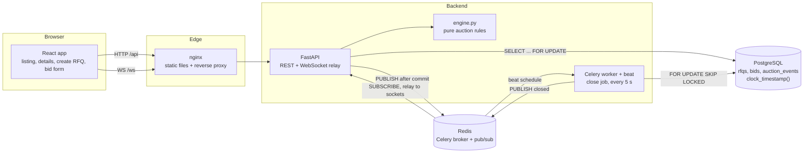

# High-level design

An RFQ system where suppliers bid down on freight quotes in a British (reverse) auction. Late activity extends the auction, but never past a forced close time.

## Architecture



| Component | Responsibility |
|---|---|
| React app | Sign-in, listing, details, create-RFQ and bid pages. Countdowns run on the server's clock (offset measured once, NTP-style). A WebSocket message triggers a refetch; polling is the fallback while the socket is down. |
| nginx | Serves the built frontend and proxies `/api` and `/ws` (with the WebSocket upgrade headers) to the API. |
| FastAPI | Validation, auth (mocked through an `X-User-Id` header), the bid transaction, read models shaped for each viewer (suppliers don't get competitors' names), and the WebSocket relay. |
| `engine.py` | Ranking, trigger evaluation, extension maths and status, written as pure functions with no I/O. This is where the auction logic lives and where most of the tests point. |
| PostgreSQL | Source of truth. Check constraints enforce the schedule invariants, including "current close never passes forced close". `clock_timestamp()` is the single clock every process uses. |
| Redis | Celery broker, plus a pub/sub channel per auction for live updates. |
| Celery worker + beat | Every 5 s, writes the closing event (with the winner) for auctions whose time has run out. Bookkeeping only: correctness never depends on it running on time. |

## Placing a bid

This is the core flow. Everything inside the transaction runs while holding a row lock on the RFQ, so bids on one auction are applied strictly one at a time.

```mermaid
sequenceDiagram
    autonumber
    participant S as Supplier (browser)
    participant A as FastAPI
    participant P as PostgreSQL
    participant R as Redis
    participant O as Other viewers

    S->>A: POST /api/rfqs/{id}/bids
    A->>P: BEGIN; SELECT rfq FOR UPDATE
    Note over A,P: concurrent bids on this RFQ wait here
    A->>P: SELECT clock_timestamp()
    Note over A: read the clock *after* the lock<br/>reject unless start <= now < current_close
    A->>P: latest bid per supplier (DISTINCT ON)
    Note over A: reject unless total < own previous total<br/>engine.apply_bid: new rank (binary search)<br/>engine.decide_extension: in window? trigger fired?<br/>new close = min(close + Y, forced close)
    A->>P: INSERT bid, events; UPDATE current_close_at
    A->>P: COMMIT
    A->>R: PUBLISH auctions:{id}
    A-->>S: 201 {rank, extended, current_close_at}
    R-->>A: message (every API replica)
    A-->>O: WebSocket push
    O->>A: GET /api/rfqs/{id} (refetch)
```

## Design decisions

**1. Status is derived from the clock, never stored.**
`auction_status(now, start, current_close, forced_close)` gives the status: `UPCOMING`, `ACTIVE`, `CLOSED` or `FORCE_CLOSED`. A stored status column could lag (the job hasn't run yet) or be forgotten in some code path. A function of time can't. An auction is `FORCE_CLOSED` when it ended exactly at its forced close time, meaning extensions pushed it as far as allowed.

**2. One clock, read after the lock.**
All time decisions use Postgres `clock_timestamp()`, so API replicas and the worker agree regardless of host clock drift. `now()` would be wrong: Postgres freezes it at transaction start, so a request that waited 2 s for the lock would be judged by a stale time. The browser only uses its clock for display, corrected by the measured server offset.

**3. A row lock per auction serializes bids.**
`SELECT ... FOR UPDATE` on the RFQ row makes "read ranking, decide extension, write" atomic per auction. Without it, two bids at 17:59:59 could both read close = 18:00 and both write 18:05: a lost extension. `tests/test_concurrency.py` fires 8 bids at the same instant and checks that the extensions chain exactly (each starts where the previous ended). Both concurrency tests fail on every run when the lock is removed. Different auctions don't contend at all.

**4. Defence in depth for the forced close rule.**
The engine computes `min(current_close + Y, forced_close)`. A CHECK constraint `current_close_at BETWEEN bid_close_at AND forced_close_at` makes a violating write impossible even if the code had a bug.

**5. Ranking: what changes when one bid arrives.**
A supplier's standing is their latest bid. Bids must strictly decrease, so latest = lowest. The ranking sorts standings by `(total, bid time, bid id)`, so ties go to whoever got there first. A new bid only moves its own supplier, and only upwards. That gives:

- **Rank changed** if and only if the supplier is new, or their position changed (`old_position != new_position`). Everyone else keeps their relative order.
- **L1 changed** if and only if the supplier at index 0 is different.
- The new position comes from a binary search over the already-sorted ranking (`bisect`), O(log n) comparisons.

The incremental update is fuzz-tested against a brute-force re-sort over 300 random sequences of 40 bids.

**6. The three triggers are nested.** Every L1 change is a rank change, and every rank change comes from a bid. So the setting is a strictness dial: `BID_RECEIVED ⊇ ANY_RANK_CHANGE ⊇ L1_CHANGE`.

**7. Live updates are hints, not data.** Messages are published only after commit and carry no state beyond "this auction changed". Clients refetch, so a lost or reordered message can't leave a client showing wrong data, only stale data until the next poll.

**8. The activity log is append-only and explains itself.** Every extension stores the previous and new close, the trigger, and a plain-language reason ("Saffron Cargo took L1 from Kestrel Freight Lines 2 min 10 s before close"). A trigger that fires when no time is left is logged as `EXTENSION_SKIPPED`, so the buyer can see why the close didn't move.

**9. Suppliers see prices, not names, and the server enforces it.** A British auction is open about price, but who is bidding stays private. Buyers get every name. A supplier gets its own bids by name and each competitor under an alias: Supplier A, B, C, in the order suppliers first bid on that RFQ. So an alias never changes once given, and it doesn't carry over to other RFQs.

- Masking happens when the response is built, not in the browser. `queries.bid_out` lists every field it sends, so a column added later can't leak by accident. Carriers are hidden along with names, since a carrier can give a supplier away.
- Log messages name suppliers too. Each event stores structured `details` (supplier ids, ranks, trigger, seconds before close), and `app/messages.py` writes the sentence for the viewer: "Supplier B took L1 from Kestrel Freight Lines" when Kestrel is reading. The version with every name is stored in `message` as the audit copy.
- Supplier ids are withheld from suppliers as well, because `/api/users` maps ids to names.
- With authentication mocked anyone can pick any account, so this is only as strong as the auth in front of it. With real tokens the same code is secure.

**10. The British auction option is one flag with constraints around it.** `british_auction = false` gives a fixed-close RFQ: no forced close, X, Y or trigger. Those four columns are nullable, and a CHECK requires all four when the option is on and none when it's off, so a half-configured auction can't exist. The bounds check became `current_close_at BETWEEN bid_close_at AND COALESCE(forced_close_at, bid_close_at)`: without a forced close, the close can't move at all. In the bid transaction `rfq.rules` is `None` for these RFQs, so the extension step is skipped and everything else (ranking, revisions, the log) is the same. Having both kinds is what makes the spec's comparison with non-extended auctions possible.

## Rules as implemented

| Rule | Behaviour |
|---|---|
| Bidding window | Open on `[bid_start_at, current_close_at)`: start inclusive, close exclusive. |
| Trigger window | Bid time in `[current_close - X, current_close)`. It trails the *current* close, so it moves with each extension. |
| Extension | `new_close = min(current_close + Y, forced_close)`. Extends from the current close, as in the spec's example (6:00 → 6:05). |
| Forced close | Must be strictly later than bid close (API validation + DB constraint). Never exceeded. |
| Revised bids | A supplier's new total must be strictly lower than their own current bid. It does not have to beat L1. |
| Ties | Equal totals rank by who bid first. |
| Rank change (trigger b) | Any supplier's rank differs before vs after the bid. A supplier's first bid counts (unranked → ranked). |
| L1 change (trigger c) | The supplier at L1 is different. L1 lowering their own price doesn't count. The first bid ever does (nobody → someone). |
| Quote validity | Must last at least until the pickup date. |
| Pickup date | Can't be before the forced close date. |
| Money | `NUMERIC(12,2)` in Postgres and `Decimal` in Python, never floats. Total is a generated column. Single currency (INR). |
| British auction off | Fixed close: no forced close, no X, Y or trigger, and no extensions. Status can be Closed but never Force closed. |
| Who sees supplier names | The buyer sees all. A supplier sees itself, and others as Supplier A, B, C (by first bid on that RFQ). Without a user, nobody is named. Prices are visible to all. |
| Supplier's own rank | The listing shows each supplier its rank on every RFQ it has bid on, from the same ordering as the engine (`row_number()` over latest bids by total, time, id). |
| Savings (buyer summary) | The lowest of each supplier's first quote minus the current lowest bid: what bidding saved compared with every supplier quoting once. |

## API

| Method | Path | Who | Purpose |
|---|---|---|---|
| GET | `/api/rfqs` | anyone | Listing: lowest bid, L1, close times, status, savings baseline, the supplier's own rank |
| POST | `/api/rfqs` | buyer | Create an RFQ, with or without the British auction option |
| GET | `/api/rfqs/{id}` | anyone | Details: ranking, all bids, config, activity log |
| POST | `/api/rfqs/{id}/bids` | supplier | Place a bid; returns rank and whether it extended |
| GET | `/api/users` | anyone | Users for the "acting as" switcher |
| GET | `/api/time` | anyone | Server time, for countdown clock sync |
| WS | `/ws/rfqs`, `/ws/rfqs/{id}` | anyone | Change notifications |

The two GETs work without a user but are shaped by `X-User-Id` when it's sent: a buyer sees supplier names, a supplier sees only its own (decision 9).

Errors are uniform: `{"detail": "...", "code": "BID_NOT_LOWER", "errors": {"field": "message"}}`. Codes include `AUCTION_NOT_STARTED`, `AUCTION_CLOSED`, `BID_NOT_LOWER` and `VALIDATION_ERROR`. Interactive docs are at `/docs` on the API.

## Scaling notes

- **API** is stateless; run more replicas behind a load balancer. Redis pub/sub fans updates out to every replica, and each replica relays to its own sockets.
- **Lock contention** is per auction. A hot auction serializes its own bids, but each transaction is a handful of indexed queries (milliseconds), far above realistic per-auction bid rates.
- **Indexes** match the hot queries: latest bid per supplier `(rfq_id, supplier_id, created_at DESC)`, lowest bid `(rfq_id, total_amount)`, the activity log `(rfq_id, created_at, id)`, and a partial index for the close job's scan (`WHERE finalized_at IS NULL`).
- **Next steps at scale:** paginate the listing and activity log, use one shared Redis subscriber per process instead of one per socket, and use real authentication (JWT) in place of the mocked header.
