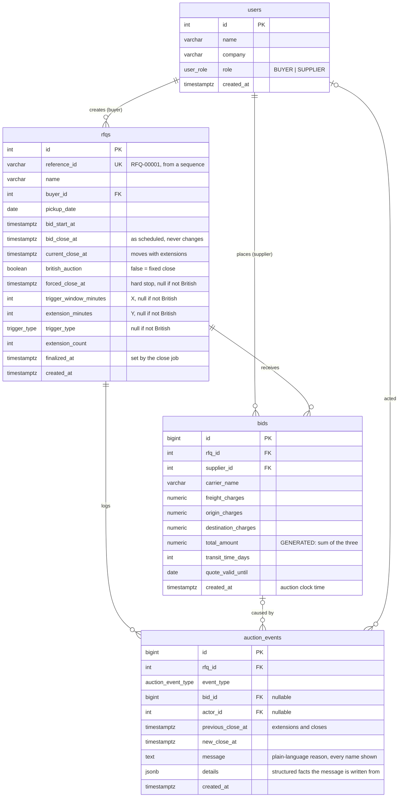

# Schema design

Four tables in PostgreSQL. The full DDL, dumped from a migrated database, is in [schema.sql](schema.sql). The migrations that create it are in `backend/alembic/versions/`: `0001` builds the schema and `0002` adds the British auction option.

## Tables

### `users`
Buyers and suppliers, distinguished by `role`. Authentication is mocked for this exercise, so there are no credentials.

### `rfqs`
One row per RFQ, holding its auction configuration and live close time.

- `british_auction` is the spec's "British Auction option". When it's off the RFQ has a fixed close, so the forced close and the extension settings (X, Y, trigger) are NULL.
- `bid_close_at` keeps the original schedule; `current_close_at` is the one that moves. Keeping both lets the UI show "extended by 6 min" and lets the timeline draw each extension.
- `reference_id` defaults to `'RFQ-' || lpad(nextval('rfq_reference_seq')::text, 5, '0')`, so references are handed out atomically by the database.
- `extension_count` is denormalized from `auction_events` so the listing page doesn't need to count events.
- `finalized_at` is only bookkeeping for the close job. There is **no status column**: status is computed from the clock (see [HLD](HLD.md#design-decisions)).

| Constraint | Why |
|---|---|
| `CHECK (bid_start_at < bid_close_at)` | A schedule has to make sense |
| `CHECK (bid_close_at < forced_close_at)` | Spec: forced close must be **later** than bid close |
| `CHECK (current_close_at BETWEEN bid_close_at AND COALESCE(forced_close_at, bid_close_at))` | Spec: extensions never exceed the forced close. Enforced even if application code is wrong. Without a forced close (not British), the close can't move at all |
| `CHECK` british_auction_settings | All four extension settings when `british_auction` is on, none when it's off. No half-configured auctions |
| `CHECK (trigger_window_minutes > 0)`, `CHECK (extension_minutes > 0)` | X and Y must be positive |

### `bids`
Every bid is kept, including superseded ones, so the full history can be shown and audited.

- Money is `NUMERIC(12,2)`, never floating point.
- `total_amount` is a **stored generated column**, so the total can never disagree with its parts. It's `NUMERIC(14,2)` so the sum of three max-size charges can't overflow.
- `created_at` is written by the application from the auction clock (`clock_timestamp()` read after the row lock), not a column default. That way it is exactly the time the extension rules were evaluated against.
- A supplier's **standing bid** is their latest one. The API only accepts strictly lower revisions, so latest = lowest.

| Constraint / index | Why |
|---|---|
| `CHECK` charges `>= 0`, `transit_time_days > 0` | No negative quotes |
| `ix_bids_rfq_supplier_latest (rfq_id, supplier_id, created_at DESC)` | `DISTINCT ON (supplier_id)`: latest bid per supplier, used to build the ranking on every bid |
| `ix_bids_rfq_total (rfq_id, total_amount)` | Lowest bid per RFQ for the listing page |

### `auction_events`
Append-only activity log: `AUCTION_CREATED`, `BID_SUBMITTED`, `EXTENDED`, `EXTENSION_SKIPPED`, `AUCTION_CLOSED`, `AUCTION_FORCE_CLOSED`.

- Extensions store `previous_close_at` → `new_close_at` plus a human-readable `message` with the reason. This is the spec's "reason for each extension".
- `details` (JSONB) holds the facts each message is written from:

  | Event | `details` |
  |---|---|
  | `BID_SUBMITTED` | `total`, `carrier`, `rank`, `previous_rank` (the bidder is `actor_id`) |
  | `EXTENDED`, `EXTENSION_SKIPPED` | `trigger`, `rank`, `previous_rank`, `previous_l1_id`, `before_close_seconds`, `requested_seconds`, `applied_seconds`, `capped` |
  | `AUCTION_CLOSED`, `AUCTION_FORCE_CLOSED` | `winner_id`, `total`, `suppliers`, `bids`, `extensions` (null when not British) |

- The message is written once per viewer from those facts. Suppliers mustn't see competitors' names, so a supplier reading the log gets "Supplier B took L1 from …" where the buyer gets the company name. `message` stores the version with every name shown, as the audit copy. See [HLD decision 9](HLD.md#design-decisions).
- `ix_auction_events_rfq_time (rfq_id, created_at, id)` serves the details page's log, newest first.

## Why the ranking isn't stored

Ranks change for every supplier whenever anyone bids, so a stored `rank` column would mean rewriting up to n rows per bid. Instead the ranking is computed from the standing bids: one indexed `DISTINCT ON` query plus an in-memory sort. That's cheap at RFQ scale (tens of suppliers). The rank a bid had *when it was placed* is kept in its `BID_SUBMITTED` event, so history is still preserved.
